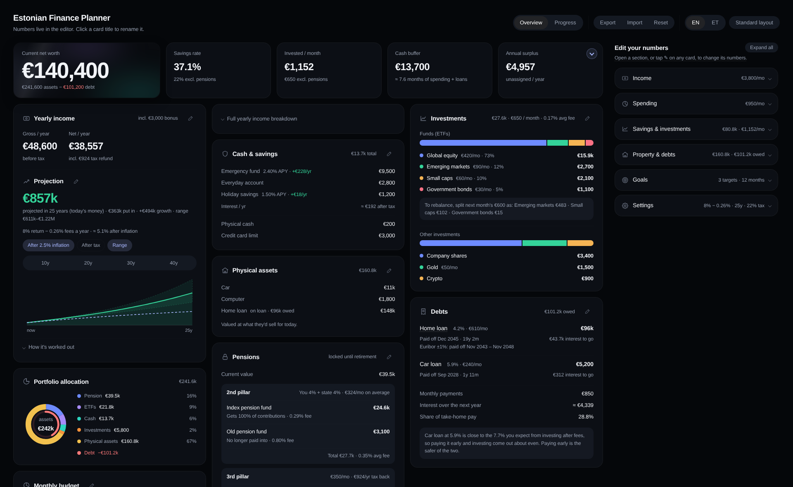
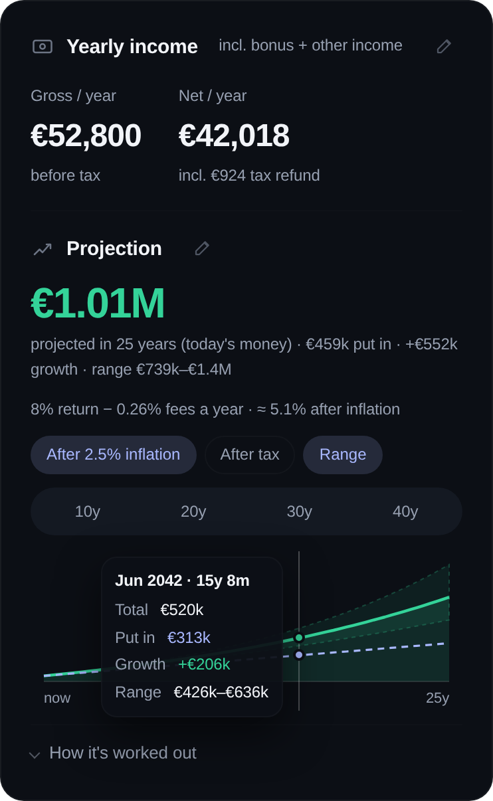
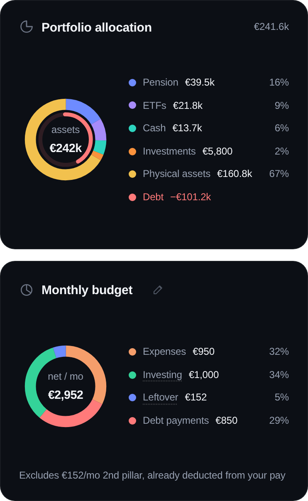
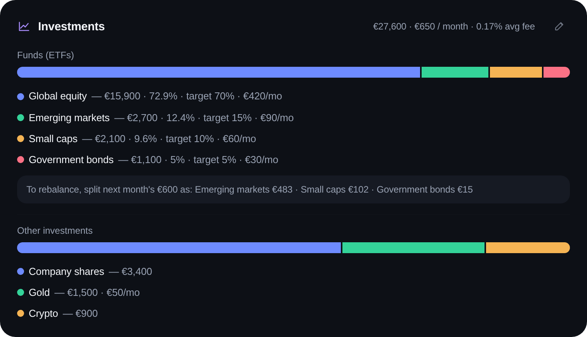
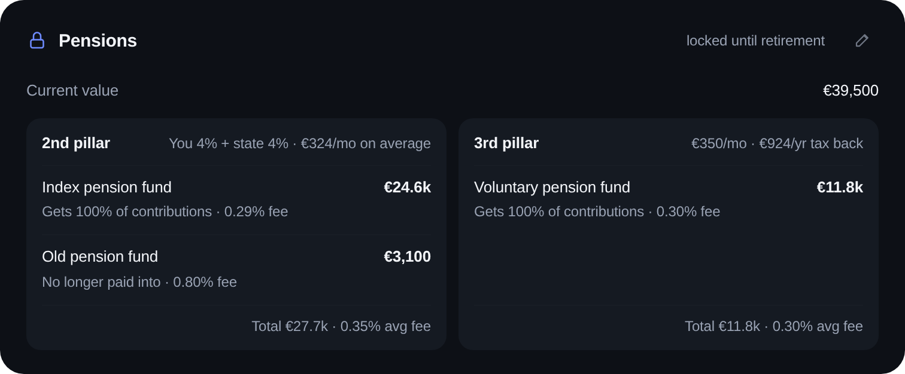
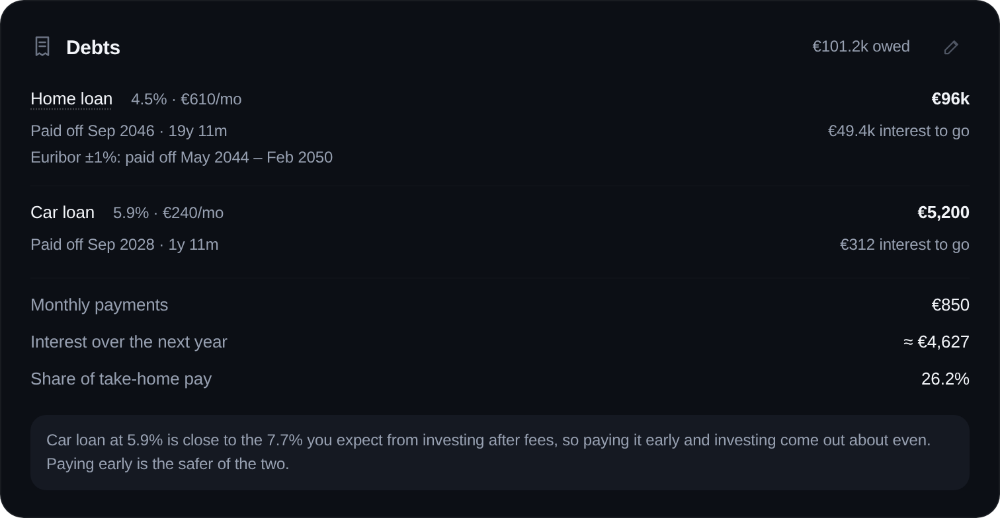
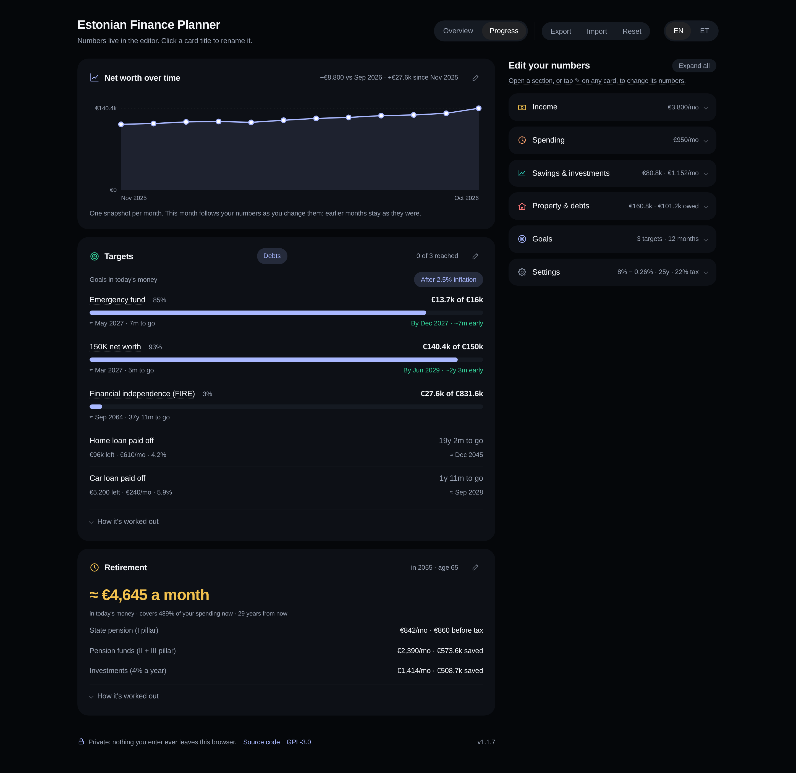
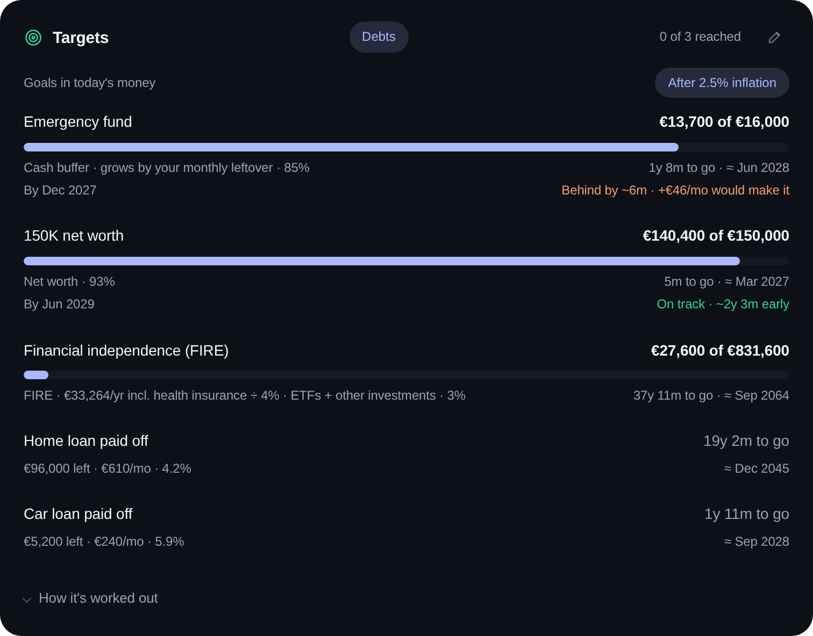
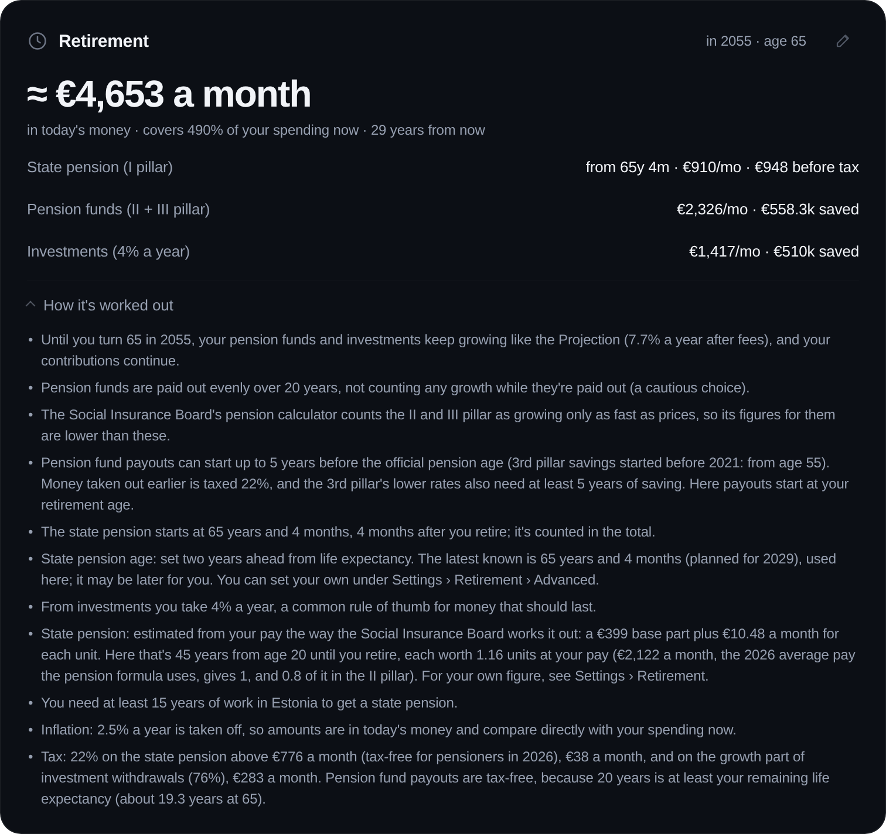
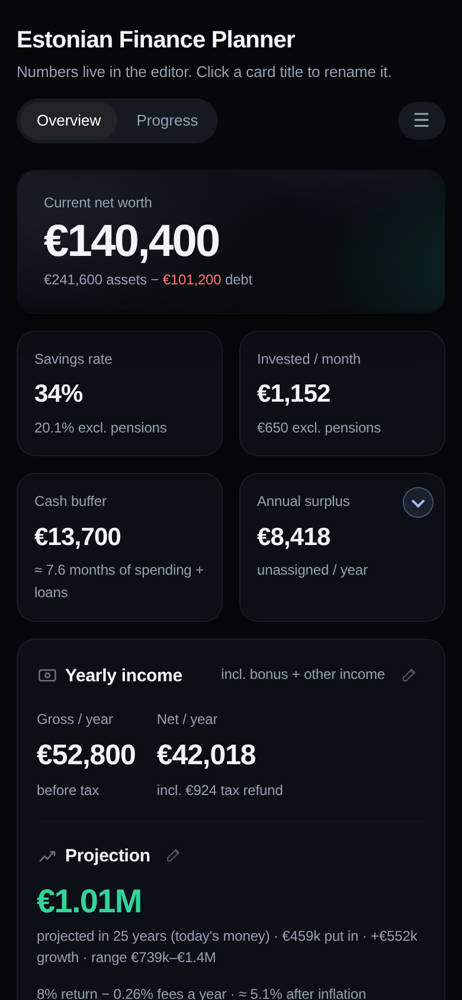

# Estonian Finance Planner

[](https://github.com/UnauthenticatedUser/Finance-Planner/actions/workflows/ci.yml)

A personal finance and investing dashboard in a single HTML file. Enter your salary, spending, savings, pensions, investments and debts, and it shows where your money goes each month, what you're worth today, where you could be in 10–40 years, and how far you are from your goals.

It runs entirely in your browser: no account, no tracking, and nothing you enter ever leaves your device. It also works offline. Tax and pension rules follow **Estonia (2026)**. The interface is in **English and Estonian**.

I built it for myself and friends in Estonia, and I'm sharing it in case it's useful to you too.

**[Open the planner](https://unauthenticateduser.github.io/Finance-Planner/)** in your browser, or download it from the [latest release](https://github.com/UnauthenticatedUser/Finance-Planner/releases/latest) to use offline.



<sub>All screenshots use made-up example numbers.</sub>

## Getting started

1. Open the planner at **[unauthenticateduser.github.io/Finance-Planner](https://unauthenticateduser.github.io/Finance-Planner/)**. It works in any modern browser (Chrome, Edge, Firefox or Safari), on a computer or a phone.
   To use it offline instead, download `estonian-finance-planner.html` from the [latest release](https://github.com/UnauthenticatedUser/Finance-Planner/releases/latest) (under **Assets**) and open it in your browser.
2. Want to see what it does first? Click **Show an example** at the top to look around with made-up numbers. They're never saved, and **Start with my own numbers** takes you back.
3. Fill in your numbers in **Edit your numbers** on the right (below the dashboard on a phone). Leave anything that doesn't apply to you empty.

Everything updates as you type. Change one number and every total, chart, target date and projection that depends on it changes with it, so you can try out "what if" scenarios: a raise, a bigger monthly investment, paying off a loan early. There's nothing to save or recalculate; your numbers are kept automatically. The assumptions behind the numbers, like tax rates, return, inflation and retirement age, can be changed too (see [How the numbers are worked out](#how-the-numbers-are-worked-out)).

Nothing to install, nothing to sign up for.

## What it shows

### Overview

<table>
<tr>
<td width="50%"></td>
<td width="50%"></td>
</tr>
</table>

- **Net worth**: everything you own minus what you owe.
- **Key numbers**: savings rate, invested per month, cash buffer (in months of spending) and your yearly surplus, with how much of it you invest.
- **Yearly income**: gross and net pay, with a full breakdown of income tax, unemployment insurance, the 2nd pillar, the state top-up and the 3rd pillar tax refund.
- **Projection**: what your pensions and investments could grow to in 10–40 years.
  - **After inflation** (on by default) shows amounts in today's money.
  - **After tax** shows what you'd keep after withdrawing.
  - **Range** shades a lower and a higher return.
- **Portfolio allocation** and **monthly budget**: where your money is, and where your take-home pay goes.
- **Cash & savings, pensions (II and III pillar), funds (ETFs), other investments, physical assets and debts**. Your ETFs can follow a target split, and the tool suggests how to split next month's purchase to get back on target without selling. The Investments and Pensions cards show the average yearly fee of your funds. Loans can have a fixed rate or Euribor plus a margin, and each shows its payoff date.







### Progress



- **Net worth over time**: one snapshot is saved each month automatically, and you can add earlier months yourself.
- **Targets** for an emergency fund, a net worth goal, an invested total, financial independence (FIRE) or your own goal. Each target shows when you'll reach it at your current pace. With a deadline, it also says whether you're on track and how much more per month it would take. Debt payoff dates can be shown alongside.
- **Retirement**: what you'd live on per month after tax, from the state pension, your pension funds and your investments.





Projection, Targets and Retirement each have a **How it's worked out** section that explains the numbers in plain words.

### Also

- **English and Estonian**: switch with EN / ET in the top bar.
- **Phones and wide screens**: the layout adapts to phones, and on wide screens there's an optional layout that uses the whole screen.
- **Editing in place**: rename any card by clicking its title. The ✎ on a card jumps to its numbers.
- **Spending by category**: yearly costs like car tax or insurance are spread over the months. A link to the Tax and Customs Board's car tax calculator shows yours by registration number.
- **Warnings**: friendly notes point out numbers that look off, such as spending above your take-home pay or fund shares that don't add up to 100%.
- **Undo**: removing something offers Undo for a few seconds.



## Your data stays on your device

- **Stored locally:** everything you enter is saved in your own browser (`localStorage`). It is never sent anywhere, and the file makes no network requests at all.
- **Enforced by your browser:** the page includes a security rule (a Content-Security-Policy) that tells the browser to block it from sending data in the background, and the code itself never sends anything. You can see the rule at the top of the file.
- **Online or offline:** the online version is the same file, served by GitHub Pages. Your numbers still stay in your browser. The online version and a downloaded copy keep their numbers separately; use **Export** and **Import** to move between them.
- **Sharing:** sharing the link or the file shares the empty tool, not your numbers.
- **Export and Import:** **Export** downloads your data as a JSON file, and **Import** loads it back on any device or browser. The tool reminds you now and then to make a backup.
- **Reset and Undo:** **Reset** starts over with an empty tool and keeps only the tax rates. **Undo** brings back your data from before the last reset or import, so a copy stays saved for that.
- **Removing everything:** **Delete all my data** (under **Settings › Your data**) deletes everything the tool has saved in this browser, including the Undo copy, and starts fresh. It asks you to click twice. Files you've exported aren't affected. Clearing this site's data in your browser settings does the same.
- **Not encrypted:** your numbers are stored as plain data in your browser, like most website data. Anyone who can use your browser profile could see them. For the best protection, use a device with disk encryption turned on (BitLocker on Windows, FileVault on Mac; phones usually have it on already) and a screen lock, and keep exported backups somewhere protected too.
- **Browser extensions:** an extension allowed to read and change data on all sites (or on this one) can see what's on the page and what it saves, as on any website, and the page's no-network rule doesn't apply to extensions. To keep your numbers away from them, limit what your extensions can access (in Chrome: right-click the extension → **This can read and change site data** → **When you click the extension**), use a browser profile without extensions, or use the downloaded file offline: Chrome extensions can't open files on your computer unless you turn on **Allow access to file URLs** for them.
- **A copy that never changes:** the online version updates when this repository does, and only after all the tests below have passed. If you'd rather run a fixed copy you've checked yourself, download the file from a [release](https://github.com/UnauthenticatedUser/Finance-Planner/releases) and open it offline.

Clearing your browser data also clears the tool, so export a backup from time to time.

## How the numbers are worked out

Rules last checked: **October 2026**.

| | Default (Estonia 2026) | Source |
|---|---|---|
| Income tax | 22% | [Ministry of Finance](https://fin.ee/en/taxes), [Tax and Customs Board: 2026 changes](https://emta.ee/uudised/maksumuudatused-2026) (in Estonian) |
| Basic exemption | €700 a month, for everyone | same as above |
| Unemployment insurance (employee) | 1.6% (from 2025 to the end of 2028) | [Tax and Customs Board](https://emta.ee/ariklient/maksud-ja-tasumine/tulumaks-ja-sotsiaalmaks/tootuskindlustusmakse) (in Estonian) |
| 2nd pillar | your 2%, 4% or 6% of gross pay, plus the state's 4% from social tax | [Pension Centre](https://www.pensionikeskus.ee/en/ii-pillar/contributions/changing-the-rate-of-contributions-to-mandatory-funded-pensions/) |
| 3rd pillar tax refund | contributions up to 15% of income, at most €6,000 a year | [Tax and Customs Board](https://emta.ee/en/private-client/taxes-and-payment/tax-incentives/contributions-supplementary-funded-pension) |
| State pension, if you don't enter your own forecast | €860 a month (national average from April 2026) | [ERR News](https://news.err.ee/1609943801/average-old-age-pension-rises-to-860-from-april) |
| Tax-free pension income for pensioners | €776 a month | [Tax and Customs Board](https://emta.ee/en/private-client/taxes-and-payment/tax-incentives/basic-exemption-pensionable-age) |
| Pension fund payouts | tax-free if spread over at least your remaining life expectancy, otherwise 10% | [Tax and Customs Board](https://www.emta.ee/en/private-client/taxes-and-payment/taxable-income/pension-and-insurance-indemnities) |
| Pension fund payouts before pension age | 2nd and 3rd pillar payouts can start up to 5 years before the official pension age (3rd pillar savings started before 2021: from 55). Money taken out earlier is taxed 22%; the 3rd pillar's 10% rate also needs at least 5 years of saving | [Tax and Customs Board](https://www.emta.ee/eraklient/maksud-ja-tasumine/maksustatavad-tulud/pensionid-ja-kindlustushuvitised) (in Estonian) |
| Remaining life expectancy at 65 | 19.3 years (2025) | [Statistics Estonia](https://stat.ee/en/news/life-expectancy-estonia-798-years-healthy-life-expectancy-573-years) |
| Retirement age | 65 in 2026; from 2027 it follows life expectancy (65 years and 1 month in 2027) | [ERR News](https://news.err.ee/1609774161/estonia-s-retirement-age-to-rise-to-65-years-and-1-month-for-2027) |
| Health insurance if you stop working before pension age | €272 a month (13% of last year's average gross wage) | [Health Insurance Fund](https://tervisekassa.ee/en/people/health-insurance/voluntary-health-insurance-01012026) |

These are only defaults. Almost every assumption can be changed in the editor:

- **Settings › Taxes › Advanced**: income tax, unemployment insurance, the basic exemption and the state's 2nd pillar top-up.
- **Settings › Projection**: return, inflation, timeframe, range, a single fee for everything and how fast your deposits grow.
- **Settings › Retirement**: year of birth, retirement age, your own state pension forecast and the pension payout period.
- **Savings & investments › Yearly surplus**: how much of your yearly surplus you invest (0% by default); the rest stays as cash.
- **Savings & investments › Pensions**: your 2nd pillar rate (2%, 4% or 6%).
- **Property & debts › Debts**: today's Euribor.
- **Goals › Targets**: the withdrawal rate of each FIRE target.

Fixed in the tool: the 10% tax on pension payouts that are a lump sum or shorter than your life expectancy, the 3rd pillar refund limits, the pensioners' €776 tax-free amount, the €272 health insurance, and the 4% a year taken from investments in **Retirement**.

How each part is calculated:

- **Growth**: money grows month by month at the return you set, minus fund fees. The default return of 8% a year is before inflation (about 5.4% after it). That's a cautious long-run figure for a portfolio spread around the world; US stocks alone have averaged about 10%. You can set it to whatever you expect under **Settings › Projection**.
- **Fund fees**: each fund's yearly fee, averaged by how much is in each fund plus a year of what you put in. Funds without a fee entered count as 0%, and the tool tells you which ones.
- **Inflation** (2.5% a year, on by default): it is taken off so amounts are in today's money. Turn off **After inflation** to see future euros instead. Goals count as today's money, so they rise with prices.
- **After tax**: income tax on investment gains above what you've put in, and pension funds taxed the way Retirement pays them out (none when spread over at least your remaining life expectancy).
- **Retirement**: pension funds are paid out evenly over 20 years (you can change this) as monthly payments. They're tax-free when spread over at least your remaining life expectancy (19.3 years at 65); a shorter period is taxed 10%, and payouts starting more than 5 years before pension age are taxed as income. From investments you take 4% a year, and the growth part of what you take out is taxed as income. The state pension starts at 65 and is taxed above the €776 a month that's tax-free for pensioners; retiring earlier, it isn't in the total. Loan payments still running at retirement count as spending.
- **Savings interest**: worked out from each account's yearly interest rate, minus income tax. Interest earned inside an investment account is only taxed when you take out more than you put in.
- **Loans**: the rate is fixed or Euribor plus your bank's margin (a negative Euribor counts as 0). Your monthly payment gives the payoff date and the interest still to pay.
- **Targets**: dates use the same growth as the projection. A cash buffer grows by the part of your yearly surplus you don't invest. The FIRE goal is your yearly spending divided by the withdrawal rate (4% by default). A FIRE target can include your own health insurance, which you pay yourself if you stop working before pension age; it's on for new FIRE targets.

All of this is a simple model with smooth average returns. Real markets go up and down, so treat the results as a rough guide.

## How the numbers are checked

The [`tests`](tests) folder checks the tool's results against calculations written separately in Python, from the rules above. They run automatically on every change, in Chromium, Firefox and Safari's engine (WebKit). The badge at the top shows the latest result, and the online version is only updated when they pass:

- **Official examples**: the tool must give the same answers as worked examples published by the Tax and Customs Board, the Pension Centre and the Social Insurance Board: payslips, the 3rd pillar refund, the tax on a state pension and on pension fund payouts. Each test quotes its source, so a misread rule can't hide behind our own formulas.
- **Calculations**: take-home pay, taxes, the 3rd pillar refund, budget, net worth and the yearly summary, for 300 random people, to the cent.
- **Forecasts**: projection, after-tax value, fund fees and loan payoff dates.
- **Retirement**: state pension (from 65), pension fund payouts and investment withdrawals, with their taxes, also when retiring early.
- **Targets**: when each goal is reached (FIRE with or without health insurance), and that the suggested extra per month really reaches a deadline.
- **Editor**: every "+ Add" button works in both languages, and car tax defaults to once a year.
- **Accessibility**: every button and field has a name for screen readers, text has enough contrast, keyboard focus is visible, and there's a "Skip to content" link.
- **Backups**: Export, Import, Reset and Undo, and that backups from earlier versions still load with nothing lost.
- **Broken files and security**: damaged or hostile backup files can't crash the page or run code.
- **Privacy**: the page makes no network requests, and only its own scripts may run.

To run them yourself, with Python 3 installed:

```
pip install -r tests/requirements.txt
python -m playwright install chromium
python tests/run_all.py
```

To use Firefox or WebKit instead, install it the same way and start the tests with `BROWSER=firefox` or `BROWSER=webkit` in front.

To leave out a slow test, add `--skip` and its name, for example `python tests/run_all.py --skip security`.

## Feedback and security

Found a mistake in a rule or a number? Please [open an issue](https://github.com/UnauthenticatedUser/Finance-Planner/issues/new/choose); there's a short form for each. Issues are public, so use made-up numbers, never your own. To report a security problem privately, see [SECURITY.md](SECURITY.md). Changes in each version are listed in [CHANGELOG.md](CHANGELOG.md).

## License

[GPL-3.0](LICENSE). You're free to use, study, change and share it. If you share a changed version, it has to stay under GPL-3.0 with its source code available.

The built-in font, Planner Sans, is a renamed copy of Liberation Sans 2.1.5 and is licensed separately under the [SIL Open Font License 1.1](https://openfontlicense.org).

## Disclaimer

This is a personal planning tool, not financial, tax or investment advice. Tax rules change, so check current rules with the [Estonian Tax and Customs Board](https://www.emta.ee/en) and your pension provider before making decisions.
